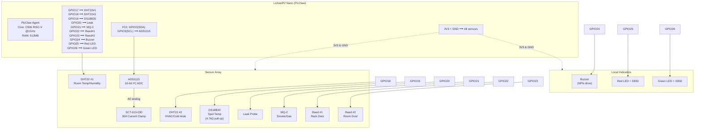

# 🔌 Wiring Guide — DC Guardian

> **Board:** LicheeRV Nano (PicClaw‑ready) | **Logic Level:** 3.3V | **Last Updated:** June 2026

---

## 📊 Pin Map (Quick Reference)

| Function | Module | LicheeRV Nano Pin | PicClaw GPIO Alias | Notes |
|----------|--------|:-----------------:|:-------------------:|-------|
| **Room temp/humidity** | DHT22 #1 (Data) | GPIO17 | `sensor.dht22_room` | 10kΩ pull‑up if module lacks one |
| **HVAC temp/humidity** | DHT22 #2 (Data) | GPIO18 | `sensor.dht22_hvac` | Keep cable < 2 m |
| **Spot temperature** | DS18B20 (Data) | GPIO19 | `sensor.ds18b20_spot` | **4.7kΩ pull‑up REQUIRED** |
| **Water leak** | Leak probe (DO) | GPIO20 | `sensor.leak` | Active HIGH when wet |
| **Smoke / gas** | MQ‑2 (DO) | GPIO21 | `sensor.smoke` | Module comparator output |
| **Rack door** | Reed switch #1 | GPIO22 | `sensor.door_rack` | Enable internal pull‑UP |
| **Room door** | Reed switch #2 | GPIO23 | `sensor.door_room` | Enable internal pull‑UP |
| **Audible alert** | Active buzzer (SIG) | GPIO24 | `indicator.buzzer` | Drive via NPN transistor |
| **Red LED** | LED + 330Ω | GPIO25 | `indicator.led_red` | Active HIGH = alert |
| **Green LED** | LED + 330Ω | GPIO26 | `indicator.led_green` | Active HIGH = healthy |
| **I²C SDA** | ADS1115 → SDA | GPIO2 (I²C0) | — | 3.3V logic |
| **I²C SCL** | ADS1115 → SCL | GPIO3 (I²C0) | — | 3.3V logic |
| **3.3V power** | All VCC pins | 3V3 (pin 1, 17, 36) | — | Max draw ~250 mA |
| **Ground** | All GND pins | GND (pin 9, 14, 39) | — | Star‑ground to one point |

---

## 🖼️ Wiring Overview (Mermaid)

---

## 📐 SCT‑013 & ADS1115 Configuration

| Parameter | Value | Notes |
|-----------|-------|-------|
| ADS1115 address | 0x48 | ADDR pin → GND |
| ADC range | ±4.096V | Default for SCT‑013‑030 output |
| SCT‑013‑030 output | 0–1V AC (at 30A) | 1.5V DC bias |
| Sample rate | 860 SPS max | PicClaw polls at 1‑minute intervals |
| Burden resistor | Built into module | No external burden needed |

> ⚠️ The SCT‑013‑030 has internal burden and bias resistors. Do **not** add external burden unless using SCT‑013‑000 (unloaded) variant.

---

## 🧪 Pre‑Power‑On Verification

1. **Continuity check:** 3V3 rail to GND rail → **open** (infinite resistance).
2. **Visual check:** No solder bridges or stray wire strands.
3. **Polarity check:** Verify all VCC→3V3, GND→GND, DATA→GPIO assignments.
4. **Pull‑up check:** DS18B20 DATA→3V3 → ~4.7kΩ.
5. **Voltage check (first power‑on):** 3V3 to GND → **3.25–3.35V**.

---

## 📍 Installation Placement Rules

| Sensor | Placement | Mounting |
|--------|-----------|----------|
| DHT22 #1 (room) | Rack exhaust path, 1.5 m above floor | Velcro or screw‑mount to rack rail |
| DHT22 #2 (HVAC) | Cold‑aisle ceiling tile or HVAC vent outlet | Zip‑tie to cable tray |
| DS18B20 | Taped to cooling loop return pipe | Kapton tape + thermal paste |
| Leak probe | Lowest floor point near cooling pipes | Sit flat on floor |
| MQ‑2 | Rack front air intake, 1U space | 3M double‑sided foam |
| Reed switches | Door frame + magnet on door edge | Adhesive backing |
| SCT‑013 | UPS/main breaker panel (on one branch) | Snap‑around installation |
| Enclosure | Rack rear, below patch panel | Velcro or L‑bracket |

---

## ⚡ Important Wiring Rules

- ✅ **Star‑ground:** All GND connections converge at one breadboard point.
- ✅ **Separate analog & digital:** Keep SCT‑013/ADS1115 wiring away from GPIO pulse lines.
- ✅ **Twisted pairs:** For DS18B20 and DHT22 cables > 1m, twist DATA and GND together.
- ⚠️ **Never clamp SCT‑013 around full cable bundle** — only individual conductors.
- ❌ **No mains voltage** on the breadboard. Ever.
- ❌ **No sensors powered before board** — board 3V3 rail should be active first.
