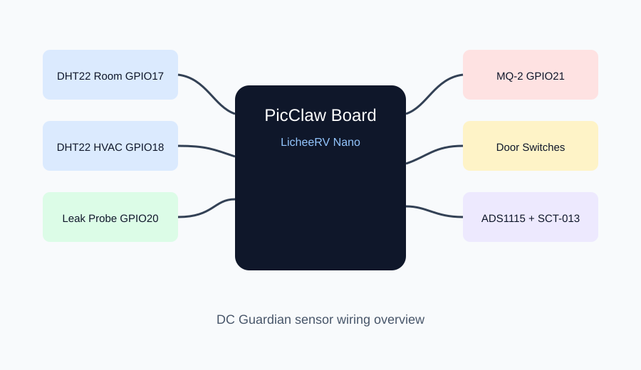

# Wiring Guide



## Pin map

| Function | Sensor/module | Board pin | Notes |
|---|---|---|---|
| Room temp/humidity | DHT22 #1 data | GPIO17 | 10k pull-up to 3V3 if module lacks one |
| HVAC/cold aisle temp/humidity | DHT22 #2 data | GPIO18 | Keep cable under 2m for reliability |
| Spot temperature | DS18B20 data | GPIO19 | 4.7k pull-up to 3V3 |
| Water leak | Leak probe digital out | GPIO20 | Place at floor drain or low point |
| Smoke/gas | MQ-2 digital alert | GPIO21 | Use module comparator output |
| Rack door | Reed switch #1 | GPIO22 | Enable input pull-up |
| Room door | Reed switch #2 | GPIO23 | Enable input pull-up |
| Current clamp | ADS1115 A0 | I2C bus | SCT-013 burden included by module |
| ADC I2C SDA | ADS1115 SDA | GPIO2 | 3V3 logic |
| ADC I2C SCL | ADS1115 SCL | GPIO3 | 3V3 logic |
| Local buzzer | Active buzzer signal | GPIO24 | Drive through transistor for loud buzzers |
| Status LED red | LED + 330Ω | GPIO25 | Alert active |
| Status LED green | LED + 330Ω | GPIO26 | Healthy |

## ASCII wiring diagram

```text
                   +-----------------------------+
                   |        LicheeRV Nano        |
                   |        running PicClaw      |
                   |                             |
  DHT22 Room   --->| GPIO17                  3V3 |----+---- DHT22 VCC / DS18B20 VCC / ADS1115 VDD
  DHT22 HVAC   --->| GPIO18                  GND |----+---- common sensor ground
  DS18B20      --->| GPIO19                      |
  Leak Probe   --->| GPIO20                      |
  MQ-2 Alert   --->| GPIO21                      |
  Rack Door    --->| GPIO22                      |
  Room Door    --->| GPIO23                      |
  Buzzer       <---| GPIO24                      |
  Red LED      <---| GPIO25                      |
  Green LED    <---| GPIO26                      |
  ADS1115 SDA <--->| GPIO2                       |
  ADS1115 SCL <--->| GPIO3                       |
                   +-----------------------------+
                                      |
                                      v
                           ADS1115 A0 analog input
                                      |
                                      v
                           SCT-013 current clamp
```

## Installation placement

- Put DHT22 #1 near the rack exhaust path.
- Put DHT22 #2 near the HVAC outlet or cold aisle.
- Tape the DS18B20 probe to the cooling loop surface or cable tray hot spot.
- Place the leak strip on the lowest floor point near cooling pipes.
- Mount reed switches so the magnet is within 5mm when the door is closed.
- Clamp SCT-013 around a single live conductor only, never around the whole cable bundle.

## Electrical safety

- Keep all low-voltage sensor wiring separated from mains wiring.
- Use non-invasive current clamps only.
- Use strain relief where cables leave the enclosure.
- Label each cable before installing in a rack.
